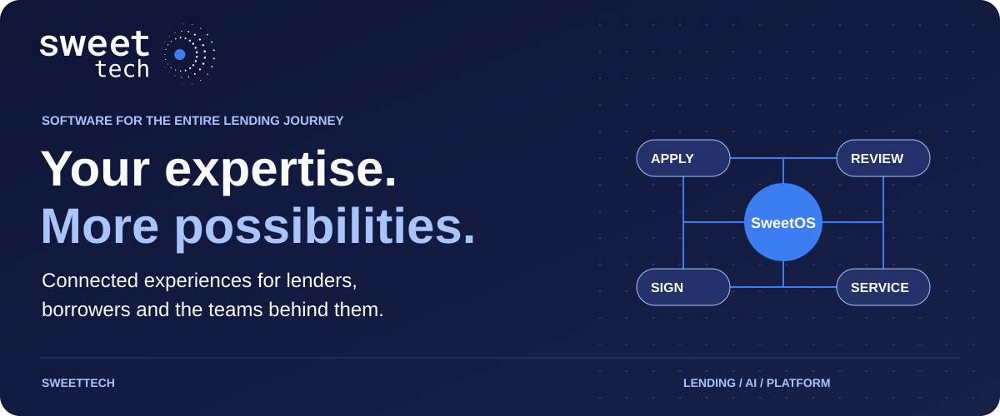
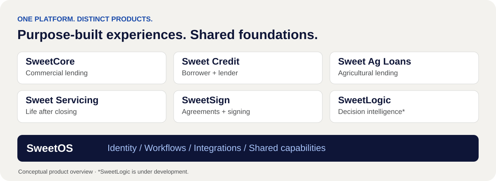
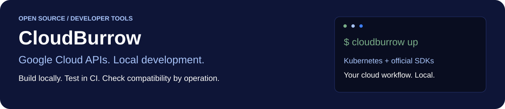

  <a href="https://sweettech.ai/"><strong>Explore SweetTech</strong></a> &nbsp; · &nbsp;
  <a href="https://sweettech.ai/company/team/">Meet the team</a> &nbsp; · &nbsp;
  <a href="https://sweettech.ai/careers/">Build with us</a> &nbsp; · &nbsp;
  <a href="https://cloudburrow.com/">Open source</a>

## Lending expertise, connected by software.

SweetTech builds commercial lending software for the institutions that move capital and the people they serve. We bring applications, document collection, origination, servicing and capital markets into connected workflows—with borrower experiences under the lender’s own brand.

Our software works alongside the core banking, loan origination and CRM systems lenders already use. The goal is practical: less time chasing information, clearer handoffs and more time for the decisions that need a person.

<table>
<tr>
<td width="33%" valign="top">

### For borrowers

Digital applications, document collection and ongoing access to their lending relationship—on the devices they already use.

</td>
<td width="33%" valign="top">

### For lending teams

Organized information and connected operational workflows, from the first application through servicing and renewals.

</td>
<td width="33%" valign="top">

### For institutions

Branded experiences and integrations that fit existing systems, with credit judgment remaining in the hands of the lender.

</td>
</tr>
</table>

## SweetOS: the foundation behind the products.

**SweetOS** is our shared platform for building financial products. Common capabilities give our teams a foundation to build on, while each product has its own purpose, experience and workflows.

Our product family is **SweetCore, SweetSign, SweetLogic, SweetBank, SweetPay and SweetVerify**.

**SweetCore includes servicing** as part of the commercial lending lifecycle, connecting borrower experiences with the teams managing origination and ongoing loan operations. **SweetSign** supports electronic signatures and agreement workflows. **SweetLogic**, under development, brings together business policies, rules, testing and human review.

Product scope and availability vary. [Explore SweetTech](https://sweettech.ai/) for demonstrations and current product information.

## AI that supports judgment.

We use AI to read documents, extract information, check completeness and flag inconsistencies. It helps teams understand what is in a file and what still needs attention.

**People retain the credit decision.** Our approach keeps review and accountability central to the workflow.

## Engineering beyond the application.

We care about the foundations that make useful software possible: reusable capabilities, understandable interfaces and tools that help developers test what they build.

That work extends beyond our commercial products into open source.

**CloudBurrow** is an open-source local Google Cloud emulator built on Kubernetes. It helps developers work with supported Google Cloud APIs through official client libraries, on their own machines and in continuous integration.

- **Develop locally:** start a dedicated local cluster and connect an application through local endpoints.
- **Test in CI:** give integration tests an isolated environment.
- **Know the boundaries:** inspect compatibility and evidence for individual operations.

[Explore CloudBurrow →](https://cloudburrow.com/)

## Build something that matters.

Financial software sits between complex operations and real people. We’re interested in engineers, product thinkers and designers who enjoy making that relationship simpler.

Explore our people and open roles, or visit the company website to discuss your institution’s workflows.

  <a href="https://sweettech.ai/careers/"><strong>Explore careers →</strong></a> &nbsp;&nbsp; · &nbsp;&nbsp;
  <a href="https://sweettech.ai/company/team/"><strong>Meet SweetTech →</strong></a> &nbsp;&nbsp; · &nbsp;&nbsp;
  <a href="https://sweettech.ai/"><strong>Visit our website →</strong></a>

